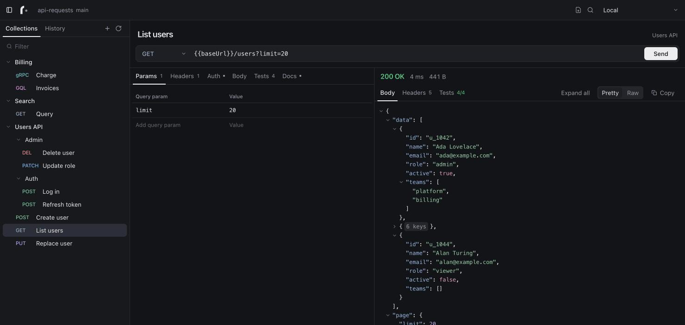

<p align="center">
  <picture>
    <source media="(prefers-color-scheme: dark)" srcset="assets/brand/mono/roundtrip-horizontal-white.svg">
    
  </picture>
</p>

<p align="center">
  A fast, local API client for HTTP, GraphQL and gRPC.<br>
  Your requests are plain, readable files that live in your own git repository.
</p>

<p align="center">
  <a href="https://github.com/bastaai/roundtrip/actions/workflows/ci.yml"></a>
  <a href="LICENSE"></a>
  
</p>

<p align="center">
  <a href="docs/getting-started.md">Getting started</a> ·
  <a href="docs/README.md">Documentation</a> ·
  <a href="docs/cli.md">CLI</a> ·
  <a href="CONTRIBUTING.md">Contributing</a>
</p>

<p align="center">
  
</p>

## Why we built it

At [Basta](https://github.com/bastaai) our services speak HTTP, GraphQL and gRPC, and every engineer keeps a collection of requests to poke at them. We were tired of the tools we used for that. They had grown into heavy applications that wanted an account before you could send a request, synced our collections to someone else's cloud, stored them in formats nobody could review, and treated gRPC and GraphQL as afterthoughts.

What we wanted was simple: a fast, focused client that starts instantly, keeps requests as plain files next to our code, lets us review a changed request in a pull request like any other change, and handles gRPC with our own `.proto` files as well as it handles a REST call.

We could not find that, so we built it, and we are making it open source because we suspect we are not the only ones who want it.

## What makes it different

- **Your requests live in git.** Every collection is one readable YAML file. Review changes in a pull request, branch them with your code, and roll them back like anything else.
- **No account, no cloud.** Roundtrip runs entirely on your machine and saves to a folder you choose. There is nothing to sign in to or connect.
- **Secrets stay local.** Environments and their values are stored on your machine only and are never written to the repository.
- **One tool for three protocols.** HTTP, GraphQL and gRPC (with `.proto` files or server reflection) share the same collections, variables and tests.
- **Runs in CI.** The same binary runs your collections from the terminal and exits non-zero when a check fails.
- **Small and quick.** A single Go binary with the interface built in. No runtime to install.

## Features

| | |
|---|---|
| **Requests** | Methods, query parameters, headers, JSON / text / form bodies, Bearer, Basic and API-key auth |
| **GraphQL** | Query and variables editors |
| **gRPC** | Unary calls using local `.proto` files with import roots, or server reflection; method suggestions and generated example messages |
| **Collections** | Nested folders, saved as you type, documented per request; history, cURL import and export |
| **Navigation** | Jump to any request with <kbd>⌘</kbd><kbd>K</kbd>, filter the tree, switch between workspaces |
| **Variables** | `{{name}}` in URLs, headers, auth, bodies and proto paths; multiple environments |
| **Tests** | Declarative checks on status, headers, body fields and timing |
| **Chaining** | Save a value from one response and use it in the next request |
| **Source control** | Saves to any folder in a git repository; shows uncommitted changes and can commit for you |
| **CLI** | `roundtrip run` for terminals and CI pipelines |
| **Desktop** | Native window on macOS; runs in any browser on macOS, Windows and Linux |

## Quick start

Roundtrip is in early development and does not have packaged releases yet. Build it from source:

```sh
git clone https://github.com/bastaai/roundtrip.git
cd roundtrip
make build
```

You need [Go](https://go.dev/dl/) 1.26 or newer, [Node.js](https://nodejs.org/) 22 or newer with [pnpm](https://pnpm.io/), and git.

Start it on a folder for your requests, ideally one inside a git repository:

```sh
./roundtrip ~/code/my-service/api-requests
```

Roundtrip opens in your browser. Select the new-request button, type a URL and press <kbd>⌘</kbd><kbd>↵</kbd> (<kbd>Ctrl</kbd><kbd>Enter</kbd> on Windows and Linux) to send it. There is no Save: every request is written to that folder as YAML as you type, ready to commit.

On macOS you can build the native app instead:

```sh
make desktop
open dist/Roundtrip.app
```

See [Getting started](docs/getting-started.md) for a full walkthrough.

## What a collection looks like on disk

```yaml
# collections/Auth.yaml
id: 9d2c6c0a51f84b17
name: Auth
requests:
  - id: 5f0c1c1e9a3b4d21
    name: Log in
    method: POST
    url: '{{baseUrl}}/login'
    body:
      mode: raw
      raw: |-
        {
          "email": "ada@example.com",
          "password": "{{password}}"
        }
      contentType: application/json
    tests:
      - target: status
        op: eq
        value: "200"
    extract:
      - var: token
        from: body.access_token
```

Each collection is one file, with its folders and requests in a fixed order and bodies written line by line, so a change to a request is a small, readable diff. The full layout is described in [File format](docs/file-format.md).

## Run collections from the terminal

```console
$ roundtrip run -workspace ./api-requests -env-file ci.yaml "Users API"
PASS  POST    Users API / Auth / Log in      200 OK  41ms
PASS  GET     Users API / List users         200 OK  18ms
FAIL  DELETE  Users API / Admin / Delete user  403 Forbidden  12ms
      status eq 204: got 403

3 requests: 2 passed, 1 failed in 71ms
```

The exit status is `0` when everything passed and `1` when a request failed, so it drops straight into a CI job. See [CLI](docs/cli.md).

## Documentation

| Guide | What it covers |
|---|---|
| [Getting started](docs/getting-started.md) | Install, first request, first collection |
| [Requests](docs/requests.md) | HTTP, GraphQL, auth, bodies, cURL |
| [gRPC](docs/grpc.md) | Proto files, import roots, reflection |
| [Variables and environments](docs/variables.md) | `{{variables}}`, environments, where values are stored |
| [Tests and chaining](docs/tests.md) | Checks on responses, saving values for later requests |
| [Source control](docs/git-sync.md) | Choosing the folder, committing, conflicts, what stays local |
| [CLI](docs/cli.md) | `roundtrip run`, CI usage, exit codes |
| [File format](docs/file-format.md) | Workspace layout and the request file reference |
| [Development](docs/development.md) | Architecture, building, testing, contributing |

## Status

Roundtrip is pre-release software. It is usable day to day, but file formats and commands may still change, and the Windows build has not been tested as thoroughly as macOS. Bug reports and feedback are welcome in [issues](https://github.com/bastaai/roundtrip/issues).

## Community

- **Questions and ideas:** [Discussions](https://github.com/bastaai/roundtrip/discussions)
- **Bugs and feature requests:** [Issues](https://github.com/bastaai/roundtrip/issues)
- **Security problems:** report them privately, as described in [SECURITY.md](SECURITY.md)

## Contributing

Contributions of every size are welcome. Read [CONTRIBUTING.md](CONTRIBUTING.md) for how to set up the project, make a change and open a pull request, and [Development](docs/development.md) for how the code is organised. Everyone taking part is expected to follow the [Code of Conduct](CODE_OF_CONDUCT.md).

Roundtrip is built and maintained by [Basta](https://github.com/bastaai). Changes are listed in the [changelog](CHANGELOG.md).

## License

Roundtrip is released under the [MIT License](LICENSE). Copyright © 2026 Basta.
